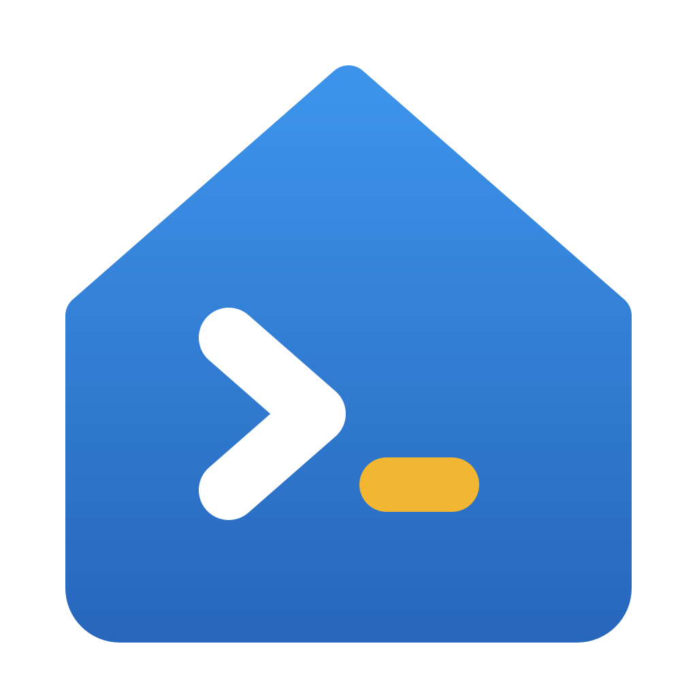
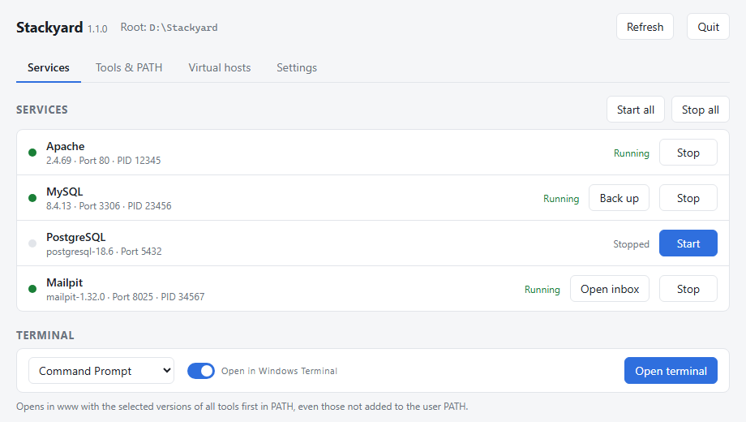
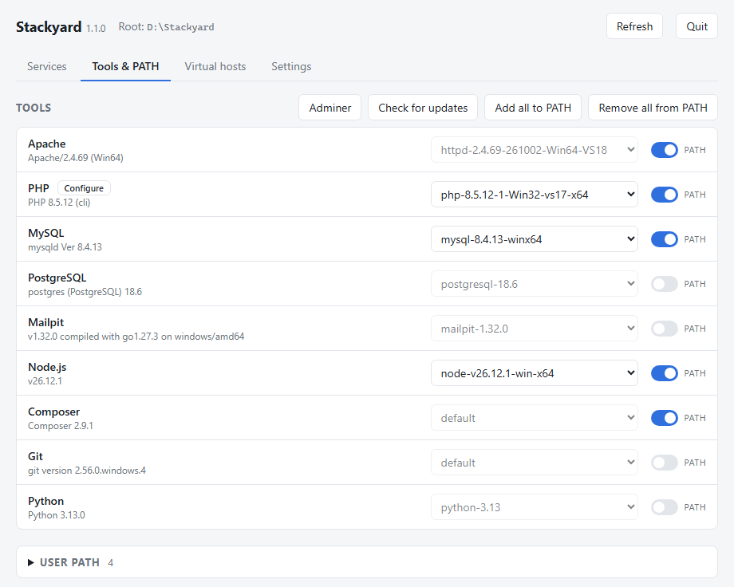
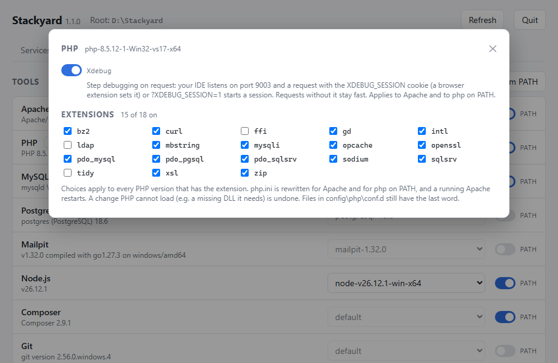
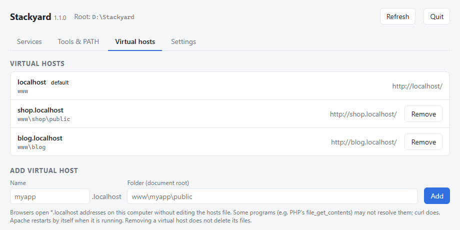

<h1 align="center">Stackyard</h1>

  A free, portable local web development stack for Windows. 
  Apache, PHP, MySQL, PostgreSQL, Mailpit, Node.js, Composer, Git and Python in one folder, with a small app to run them.

  <a href="https://github.com/thomasd333/stackyard/releases/latest"><b>Download</b></a> ·
  <a href="https://lifeart.com.pl/stackyard/">Website</a> ·
  <a href="https://ko-fi.com/thomasd333">Chip in a coffee</a>

  <picture>
    <source srcset="site/screenshots/services-dark.png" media="(prefers-color-scheme: dark)">
    
  </picture>

## Why

Stackyard is a light alternative to Laragon, XAMPP or WAMP: unzip it, run `Stackyard.exe`, press
**Start all**, and `http://localhost/` works. No installer, no Windows services, no admin rights.
Everything, settings and databases included, lives in the folder you unzipped, so you can move it
to another drive or copy it to a USB stick.

## Features

- **Services:** start and stop Apache, MySQL, PostgreSQL and Mailpit, one by one or all at once. Port
  conflicts are detected and named (for example "port 80 is used by Laragon"). Crashed services are
  noticed and their log tail is shown.
- **Mail catcher:** PHP's `mail()` (or your app's SMTP settings, `127.0.0.1:1025`) delivers to
  [Mailpit](https://mailpit.axllent.org/), which keeps every message in a web inbox instead of sending it.
- **Xdebug and PHP extensions:** switch Xdebug on (downloaded from xdebug.org for your PHP version)
  and turn extensions on or off with checkboxes. A change PHP can't load is undone.
- **Database backups:** one click dumps MySQL or PostgreSQL to a `.sql` file. Switching to a database
  version that keeps its data elsewhere tells you where your databases are.
- **Versions side by side:** keep several versions of PHP, Node.js and the others and switch from a
  list. A running service restarts on the new version.
- **Updates in the app:** check for and download new PHP, Node.js, Composer and Mailpit versions,
  verified with SHA-256.
- **PATH management:** add the selected tools to your Windows user PATH with one switch (a backup is
  kept before every change), or open a terminal (cmd, PowerShell, Git Bash, Windows Terminal) with
  every tool already on PATH.
- **Virtual hosts:** `shop.localhost` -> `www\shop\public` in two clicks. `*.localhost` needs no hosts
  file edit and no admin rights.
- **Adminer** for MySQL and PostgreSQL, one click away, already logged in to the local servers.
- **Tray icon:** closing the window keeps the services running; start with Windows and restore the
  services that were running.
- **SQL Server drivers** (`sqlsrv`, `pdo_sqlsrv`) are enabled when present, for Laravel apps on MS SQL.
- Light and dark theme; English, German, Spanish, French, Polish, Portuguese (Brazil) and Ukrainian.
- Small: the app is a ~5 MB native executable (Rust + Tauri).

  
  
  

## What's in the download

| Tool | Version |
|---|---|
| Apache (Apache Lounge) | 2.4.69 |
| PHP (Thread Safe x64) | 8.3 |
| MySQL Community Server | 8.4 LTS |
| PostgreSQL | 18 |
| Mailpit | 1.32 |
| Node.js | 26 |
| Composer | 2 |
| Git for Windows (portable) | 2.56 |
| Python | 3.13 |
| Adminer | 6.2 |

The Visual C++ runtime the servers need is included, so there is nothing else to install. Other
versions: unzip them into `bin\<tool>\<version>\` and press **Refresh**.

## Quick start

1. Download the zip from [Releases](https://github.com/thomasd333/stackyard/releases/latest).
   The `-lite` zip is the same without MySQL and PostgreSQL, about 120 MB smaller.
   Before unzipping: right-click > Properties > **Unblock**.
2. Unzip to a folder with only English letters in its path, e.g. `D:\Stackyard`. Spaces are fine;
   letters like `ą` or `é` are not, because PHP and MySQL cannot handle them.
3. Run `Stackyard.exe`. It is not code-signed yet, so SmartScreen may warn you:
   **More info** > **Run anyway**.
4. **Start all**, then open `http://localhost/`. Put your projects in `www\`.

MySQL: user `root`, no password, port 3306. PostgreSQL: user `postgres`, no password, port 5432.

**Coming from Laragon?** Quit Laragon (or change Stackyard's ports), copy your projects into `www\`
or add virtual hosts pointing at their current folders. `project.test` becomes
`project.localhost`. A MySQL 8.4 data folder can be copied over as is; see `README.txt` in the zip
for the details.

## Requirements

Windows 10 or 11, x64, with Microsoft Edge WebView2 (part of Windows 11 and of an up-to-date
Windows 10).

## Building from source

Stackyard is a Tauri 2 app: a Rust backend and a TypeScript frontend without a framework. See
[app/README.md](app/README.md).

## License

Stackyard is released under the [MIT License](LICENSE). The bundled tools keep their own licenses;
see [THIRD-PARTY.txt](app/scripts/THIRD-PARTY.txt).

## Support

Stackyard is free. My Claude subscription isn't. [Chip in a coffee?](https://ko-fi.com/thomasd333)

Bug reports and ideas are welcome in [Issues](https://github.com/thomasd333/stackyard/issues).

Built with Claude Code. Not affiliated with or endorsed by Anthropic.
